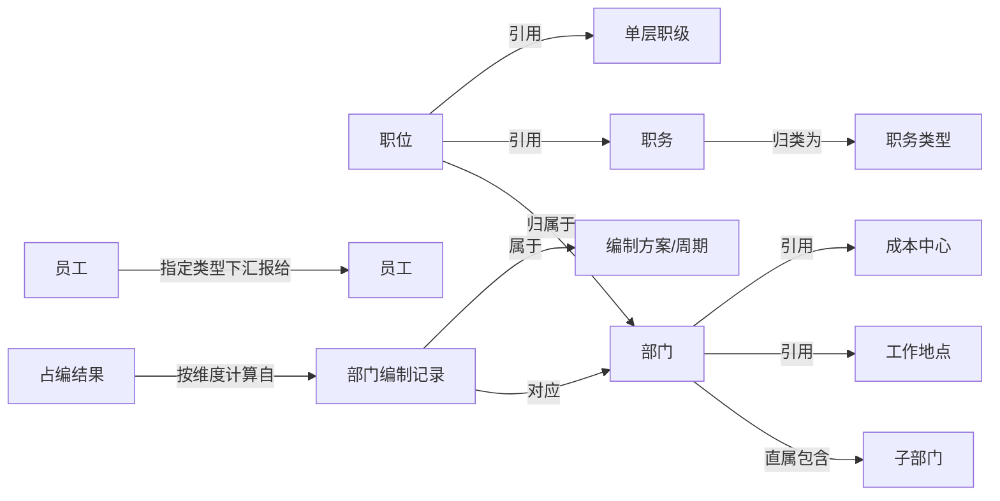

# 组织架构与编制

## 1. 模块定位

Organization 描述企业“如何组织工作”，包括组织单元、职位与职务、职级体系、员工汇报关系，以及工作地点、成本中心和编制。它回答“组织中有哪些定义、它们如何关联、在什么状态、时间和权限范围内成立”。

Organization 不保存员工完整档案，也不是所有 HR 结果的汇总入口。员工当前任职只引用这里的部门、职位、职务和职级定义；员工是否已经入职、调动或离职仍由 Staff 的当前信息和生命周期记录判断。

## 2. 主要业务内容

| 业务主题 | 本模块负责 | 需要区分 |
| --- | --- | --- |
| 组织结构 | 部门节点、父子层级、虚拟/停用状态、负责人和当前组织树摘要 | 部门树不是员工汇报树 |
| 职位与职务 | 部门中的具体职位，以及被职位引用的职务和职务类型定义 | 职位实例、职务定义和职务类型不能混用 |
| 职级体系 | 职级体系设置、体系树、序列、职层、职级分组和单层职级 | 名称相近不代表对象相同或层级已被证明 |
| 汇报关系 | 指定员工、汇报类型和层级范围下的人员关系树 | 人员关系不能从部门父子关系推导 |
| 工作地点与成本中心 | 可被部门等组织对象引用的地点和财务归集定义 | 二者都不是组织树节点 |
| 编制 | 方案周期下的部门编制记录、计划人数、预算、控编维度和占编结果 | 计划编制、职位容量、组织人数和占编数口径不同 |

## 3. 核心业务对象

| 对象 | 定义 | 身份或定位条件 | 关键属性 | 详细说明 |
| --- | --- | --- | --- | --- |
| 部门 | 组织结构中的业务单元 | `departmentId` | 父部门、名称、编码、状态、负责人、地点、组织属性 | [业务对象与关系](business-objects-and-relations.md#部门组织节点) |
| 组织树节点 | 组织树返回的展示节点，可能是部门或职位节点 | `id/nodeId` | 父节点、节点类型、层级和展示范围 | [业务对象与关系](business-objects-and-relations.md#部门组织节点) |
| 职位 | 某个组织范围内可被员工任职的具体岗位实例 | `positionId` | 编码、所属部门、职务、职级、状态、生效日期、容量 | [业务对象与关系](business-objects-and-relations.md#职位) |
| 职务 | 描述工作性质或专业角色的定义，可被多个职位引用 | `jobTitleId` | 编码、职务类型、允许职级范围、生效日期 | [业务对象与关系](business-objects-and-relations.md#职务与职务类型) |
| 职务类型 | 对职务定义进行分类的业务对象 | `jobCategoryId` | 名称、编码 | [业务对象与关系](business-objects-and-relations.md#职务与职务类型) |
| 职级体系 | 一套职级制度及其适用设置 | `gradeSystemId` | 名称、设置、树节点 | [业务对象与关系](business-objects-and-relations.md#职级体系对象) |
| 职级序列 | 职级体系中的业务序列 | `sequenceId` | 名称、排序 | [业务对象与关系](business-objects-and-relations.md#职级体系对象) |
| 职层 | 职级架构中的层级定义或过滤对象 | `gradeLevelId` | 名称、排序 | [业务对象与关系](business-objects-and-relations.md#职级体系对象) |
| 职级分组 | 单层职级的分组视图 | `positionGradeGroupId` | 名称、状态、所含职级 | [业务对象与关系](business-objects-and-relations.md#职级体系对象) |
| 单层职级 | 可被职位引用的具体职级定义 | `positionGradeId` | 名称、分组、序列条件 | [业务对象与关系](business-objects-and-relations.md#职级体系对象) |
| 员工汇报关系 | 指定类型下员工与上级/下级员工之间的关系事实 | `staffId + reportToType + 查询时点`；没有独立公开关系 ID | 汇报类型、向上/向下层级、节点权限 | [业务对象与关系](business-objects-and-relations.md#员工汇报关系) |
| 工作地点 | 企业可引用的办公地点定义 | `companySiteId` | 名称、国家/省/市/区县 code、地点类型 | [业务对象与关系](business-objects-and-relations.md#工作地点) |
| 成本中心 | 企业用于财务归集的定义 | `costCenterId` | 名称、编码、有效状态 | [业务对象与关系](business-objects-and-relations.md#成本中心与分组) |
| 编制方案/周期 | 决定部门编制事实适用区间和管控方式的方案上下文 | `hcYearId`、`hcYearPlanId` 或周期 ID；以具体命令返回为准 | 名称、开始/结束日期、周期类型、管控方式 | [业务对象与关系](business-objects-and-relations.md#编制方案与部门编制记录) |
| 部门编制记录 | 某方案周期中对应一个组织部门的编制计划记录 | 编制记录 `id/hcDepartmentId`，不是 `departmentId` | 部门引用、计划/直属人数、预算、发布状态、是否可细分 | [业务对象与关系](business-objects-and-relations.md#编制方案与部门编制记录) |
| 控编维度 | 对一条部门编制记录进行细分和计算的列定义与条件 | `hcDepartmentId + fieldName + fieldValue` 等条件组合 | 列键、层级、过滤能力、条件操作符、维度值 | [业务对象与关系](business-objects-and-relations.md#控编维度与占编结果) |
| 占编结果 | 指定部门编制记录和维度条件下的服务端计算结果 | `hcDepartmentId + controlDimensions + 查询时点` | `dimensionOccupyCount` | [业务对象与关系](business-objects-and-relations.md#控编维度与占编结果) |

对象表中的属性是业务判断索引，不是完整命令契约。各对象 Reference 必须列出当前 CLI 投影中可解释的固定字段；权限、渲染和内部传输字段要明确标为非业务字段或未公开。完整参数必填性、默认值和返回路径仍以具体命令 Help、Schema 或命令导航指定的过渡契约为准。

## 4. 关键关系与判断

| 来源对象 | 关系 | 目标对象 | 数量 | 成立条件/时点 | 事实来源 | 禁止推断 |
| --- | --- | --- | --- | --- | --- | --- |
| 部门 | 直属包含 | 子部门 | 1:N | 当前或命令指定生效日期及节点范围 | 组织树或直属子部门结果 | 不能推出员工汇报关系 |
| 职位 | 归属于 | 部门 | N:1 | 职位记录的有效状态/生效日期 | 职位查询返回的 `departmentId` | 不能推出某员工当前任职该职位 |
| 职位 | 引用 | 职务 | N:1，可空性以返回为准 | 职位记录返回该引用时 | `jobTitleId` | 同名不能作为引用证据 |
| 职位 | 引用 | 单层职级 | N:1，可空性以返回为准 | 职位记录返回该引用时 | `positionGradeId` | 不能推出薪资或绩效等级 |
| 职务 | 归类为 | 职务类型 | N:1，可空性以返回为准 | 职务记录返回该引用时 | `jobCategoryId` | 职务类型不能替代职务或职位 |
| 部门 | 引用 | 工作地点/成本中心 | N:1，可空性以返回为准 | 组织节点当前返回 | 组织树中的地点/成本中心引用 | 引用对象不是组织节点 |
| 员工 | 在指定汇报类型下汇报给 | 员工 | 未声明 | 当前租户有效 `reportToType` 和查询时点 | 汇报关系树 | 不能从部门父子关系推导 |
| 部门编制记录 | 对应 | 部门 | N:1 | 指定编制方案周期 | 编制部门搜索结果 | `hcDepartmentId` 不能当 `departmentId` |
| 部门编制记录 | 属于 | 编制方案/周期 | N:1 | 方案周期有效范围 | 编制记录中的方案和周期字段 | 不能推出方案已审批或员工已占编 |
| 占编结果 | 按控编维度计算自 | 部门编制记录 | N:1 | 指定维度条件和查询时点 | `occupy-count` 返回 | 空维度结果不能解释为整个部门人数 |

图只展示高价值关系摘要，关系表才是关系含义、时点、数量和禁止推断的事实入口。职级体系内部层次只按当前租户命令真实返回解释，不从对象名称补画未经确认的父子关系。

## 5. 边界与限制

### 相邻模块边界

- Staff 保存员工当前任职对部门、职位、职务和职级的引用，并负责员工入转调离事实；Organization 负责被引用定义。
- Recruit 的招聘职位、候选人、申请和 Offer 不等于 Organization 的职位实例。
- Payroll、Smart KPI 和 Attendance 各自负责薪资等级、绩效结果和考勤地点/结果；不能用 Organization 的职级或地点定义替代。

### 当前执行边界

- 当前公开范围全部只读，覆盖组织树、职位/职务、职级、汇报关系、地点、成本中心和部分编制查询。
- `organization headcount-dimension child-hc-count` 以及 `organization position-grade switch` 当前未注册，不属于 Agent 可执行范围。
- 不支持组织对象写入、员工实际在岗名单、薪资成本和考勤结果。组织树和职位的生效日期按命令参数过滤；没有公开的历史快照导出命令。各部门按周期的计划编制用编制部门查询组合。
- 普通分页查询只读取当前确认页。统计分析类目标在筛选明确且 `totalPages`/`totalElements` 可靠时，允许按同一条件从第 1 页串行翻页；禁止并发请求多页，禁止自动重试。树查询、单对象读取和没有可靠分页的 LIST 命令不自动翻页或递归补查。
- 结果受当前租户、功能权限和数据范围影响；空树、空列表、空对象或 `hasAuth=false` 不证明业务对象不存在。

### 易错判断

- “上级/下属”必须先区分部门父子关系和员工汇报关系。
- “岗位/职位”通常是职位实例；“职务”是工作角色定义；“职级”还需区分体系、序列、职层、分组和单层职级。
- 当前组织树、生效日期筛选、职位生效日期和编制周期是不同时间事实。
- 组织节点人数、职位容量、计划编制和占编结果不能互相替代。

### Agent 第一次判断

1. 先判断对象是部门、组织树节点、职位、职务、职级、汇报关系、地点、成本中心还是编制。
2. 自然语言查询读取 [Organization 查询语义](query-semantics.md)：先走快路径，未命中则在公开命令面上组合；只有能力缺口或非法推断才停止。
3. 名称或编码转 ID 使用 `ihr-master-data`，不要用组织树凑 ID。
4. 已明确对象且目标可由一个命令完成时，直接到[公开命令导航](commands.md)；核对计划编制和指定维度占编时才读取编制检查 Use Case。

## 6. 进一步读取

| 当前问题 | 读取内容 |
| --- | --- |
| 自然语言查询、快路径、命令面组合和明确禁止 | [Organization 查询语义](query-semantics.md) |
| 对象定义、关键属性、关系、时点和禁止推断 | [业务对象与关系](business-objects-and-relations.md) |
| 术语、简称和概念辨析 | [术语与概念辨析](terminology.md) |
| 组织结构字段、父子关系、虚拟/停用节点和生效日期 | [组织结构](organization-structure.md) |
| 职位、职务和职务类型字段及上下文 | [职位与职务](position-and-job.md) |
| 职级体系各对象字段、序列和层级 | [职级架构](grade-architecture.md) |
| 员工汇报关系字段和动态类型发现 | [汇报关系](reporting-lines.md) |
| 地点、成本中心及其分组字段 | [地点与成本中心](locations-and-cost-centers.md) |
| 编制记录、控编维度和占编结果字段 | [编制管理](headcount.md) |
| 全部公开命令、返回摘要和契约入口 | [公开命令导航](commands.md) |
| 核对编制部门、维度和占编结果 | [编制检查](../use-cases/headcount-inspection/guide.md) |

组织结构、职位上下文、职级解释和单员工汇报树均由本 Overview、对应业务 Reference 和命令导航处理，不再建立 Use Case。明确命令请求使用命令快速路径。
