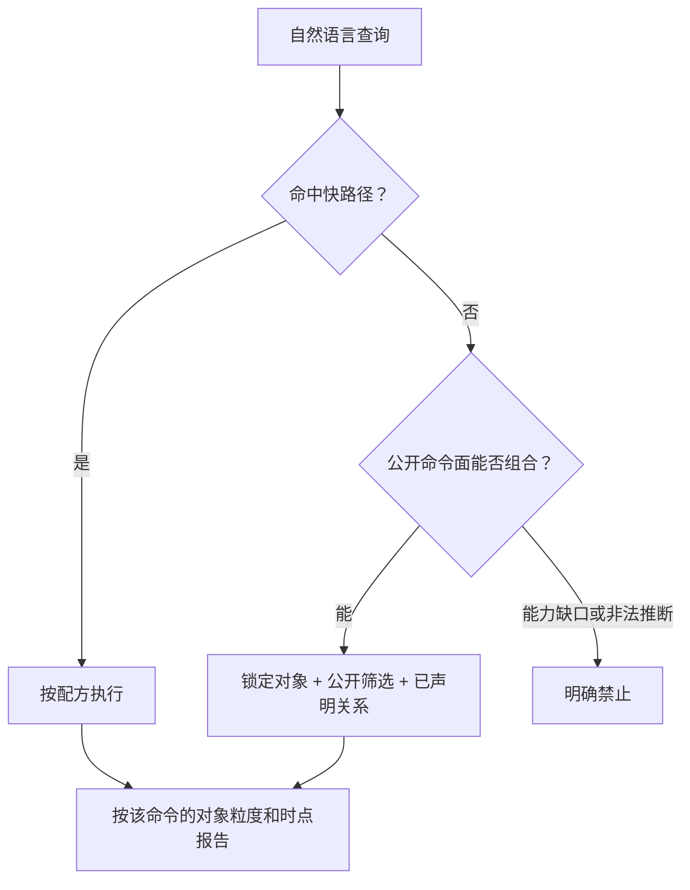

# Organization 查询语义

把自然语言落到当前公开命令上。先按快路径执行；没命中就用公开筛选和已声明关系组合。分页遵循 [`ihr-shared` 查询分页](../../../ihr-shared/SKILL.md#查询分页)。有分页契约的列表在统计分析、明确全量或需要完整结果集时可串行翻页；树查询、单对象读取和没有可靠分页的列表不自动翻页或递归补查。

## 1. 快路径

命中下表时直接用配方。未命中时继续组合公开命令。

| 用户问法 | 对象 | 命令配方 | 结果应如何称呼 |
| --- | --- | --- | --- |
| 看组织架构、某节点下级组织树 | 组织树节点 | `organization +orgTree` | 当前确认范围的树；节点摘要不是 Staff 去重人数 |
| 某部门的直属下级部门 | 部门 | `organization +departmentChildren` | 只多一层 `subDepartments` |
| 某部门的上级链 | 部门 | `organization +departmentAncestors` | 通常包含目标部门自身 |
| 某部门有哪些职位 | 职位 | 先解析 `departmentId`，再 `organization +positions` | 职位实例列表或分页总数，不是职务定义 |
| 查职务、职务类型 | 职务 / 职务类型 | `organization +jobTitles` / `+jobCategories` | 定义对象，不是某部门下的职位 |
| 查职级体系、序列、职层、分组、单层职级 | 对应职级对象 | 对应 `+gradeSystems` / `+gradeSystemTree` / `+gradeSequences` / `+gradeLevels` / `+positionGrades` / `+positionGradeList` | 各对象不能因名称相近互换 |
| 某人的汇报关系 | 员工汇报关系 | 唯一员工 + 已解析 `reportToType` 后 `organization +reportToTree` | 人员关系树，不是部门树 |
| 工作地点 / 成本中心 | 地点或成本中心 | `organization +companySites` / `+costCenters` / `+costCenterGroups` | 定义对象，不是组织树节点 |
| 某方案周期的部门编制 | 部门编制记录 | `organization headcount-department search` | 计划编制记录；`hcDepartmentId` 不是 `departmentId` |
| 各部门按月或按周期的计划编制 | 部门编制记录 | `organization headcount-department search`，用 `hcYearId` 或 `startDate`/`endDate` 限定周期 | 按返回的部门与周期字段报告 `totalHcCount`/`directHcCount`；这是计划编制 |
| 指定维度的占编数量 | 占编结果 | 已确认编制记录上 `headcount-dimension by-id`，再 `occupy-count` | `dimensionOccupyCount`；空维度不等于部门总人数 |

名称、编码转 ID 一律走 `ihr-master-data`。禁止用 `+orgTree` 扫树匹配名称来充当部门解析。

## 2. 组合规则

未命中快路径时，按当前公开命令面组合。对象和关系仍以 [Organization Overview](overview.md)、[业务对象与关系](business-objects-and-relations.md) 和 [术语与概念辨析](terminology.md) 为准。

1. **先锁定对象。** 部门、组织树节点、职位、职务、职级体系内各对象、汇报关系、地点、成本中心、编制方案、部门编制记录和占编结果不是同一个查询。“上级/下属”必须先区分部门父子和员工汇报。
2. **定位身份。** 部门/职位/职务/职级/地点/成本中心的名称或编码转 ID 使用 `master-data +search`；0/1/N 同样处理，禁止抢第一条。汇报树必须先有唯一员工和当前租户有效的汇报类型。编制 `by-id` / `occupy-count` 只能使用 `headcount-department search` 已经返回并确认的编制记录 ID。
3. **只用公开筛选和已声明关系。** 生效日期、停用/虚拟节点、职位状态等以对应命令公开参数为准。不要把组织树节点 ID、部门 ID、职位 ID 和编制记录 ID 互换。
4. **分页总数是该行粒度的匹配数。** `PAGE_RESULT` 的 `totalElements` 是当前筛选下该对象行数，例如职位数、职务数、地点数或编制记录数。仅当用户只要数量、总数已能完整回答、并且没有要求拉取全部行时，才用总数。`LIST` / `TREE` 若契约不承诺总数，就不能把当前返回当成全量计数，也不自动翻页或递归补查。
5. **未登记也可以查。** 例如“研发下面有哪些启用职位”：先解析研发 `departmentId`，再按职位命令的公开状态/日期筛选。多个月份或周期的计划编制，用编制部门查询返回的周期字段并列报告。
6. **四种人数不能互换。** 组织树/`departmentChildren` 的在职人数摘要、职位 `capacity`、编制计划人数、占编计算结果是四种事实。回答时使用命令实际返回的字段名和对象名。
7. **完整列表和返回字段分析可以串行翻页。** 用户明确要完整列表、统计分析，或需要先拿到完整结果再处理时，在范围明确、分页元数据可靠的前提下，对 `PAGE_RESULT` 命令保持筛选不变，从首页按页码顺序串行翻页；**禁止并发请求多页**，禁止自动重试。每页条数以该命令 Help/reference 为准，不要臆造 `pageSize`。编制查询不枚举编制记录 ID。同一命令已返回的字段可以做去重、分组或分布，必须说明是否完整覆盖。
8. **口径不能升级。** 结果只能称为当前筛选下的该对象列表/行数/分布，不能升级成 Staff 去重在职人数或官方编制占用。

有分页契约的列表才用 `totalElements` 回答“有多少”；树和没有分页契约的列表按实际返回解释。

## 3. 明确不支持

只停止下面两类目标。快路径里没有，不是停止理由。

### 能力缺口

- 没有公开的组织历史快照导出。组织树 `--effective-date`、职位生效日期条件按命令参数使用；结果是按该日期过滤后的当前返回，不要说成已经还原了那天的完整组织。
- 编制方案的审批办理、写入，以及未注册的 `headcount-dimension child-hc-count`；
- 员工实际在岗名单、去重在职人数、离职率；Organization 没有这些公开命令；
- 薪资成本、考勤地点结果、招聘职位 HC 与 Organization 职位实例的混算；
- 用当前命令未返回或未公开的字段做分组、分布或聚合。

### 非法推断

- 把 `onJobHeadCount` / `inServiceNumber` 说成 Staff 花名册去重人数或官方在职人数；
- 把空维度 `occupy-count` 说成整个部门人数；
- 从部门父子关系推导员工汇报关系，或从职位归属推导某员工当前任职；
- 用空树、空列表、`hasAuth=false` 证明对象不存在；
- 用职务数、职级数、地点数或成本中心数代替部门数或人数。

## 4. 执行提醒

1. 先按[公开命令导航](commands.md)定位命令，再读该条目要求的 Help、Schema 或过渡 Reference。
2. 未给时间的“现在”使用命令执行时点；组织树、职位生效日期和编制周期仍要按实际使用的日期字段分开说。
3. 每个计数、树结果或分布至少说明：对象粒度、筛选、时点、权限范围、数据来源和是否完整覆盖。
4. 当前公开命令全部只读。核对计划编制和指定维度占编时，才进入编制检查 Use Case。
