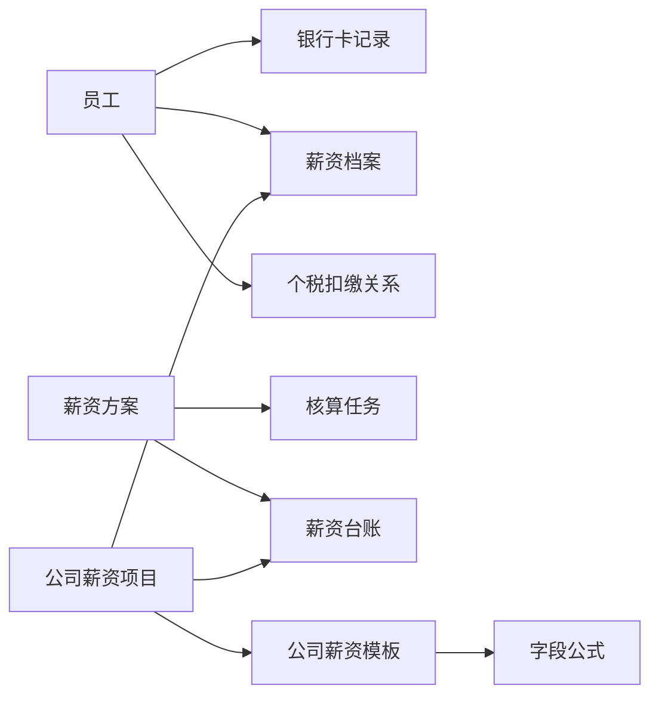

# 薪资查询、核算结果与公司薪资配置

## 模块定位

Payroll 管理“按什么规则计算薪资、当前配置是什么、某期形成了什么结果，以及与发薪相关的人员信息”。本模块帮助 Agent 区分人员银行卡、薪资档案、薪资方案、核算任务、薪资台账、个税扣缴关系、公司薪资项目、公司薪资模板和薪资公式，并在当前公开命令范围内查询或配置这些内容。

Payroll 不是员工花名册、组织主数据、考勤结果或社保福利的替代入口，也不是通用工资分析引擎。业务上存在但 CLI 尚未公开的核算提交、工资条发送、个税申报写入和任意统计，不得通过相邻命令或原生接口补齐。

## 主要业务内容

| 业务主题 | 业务含义 | 需要区分 |
| --- | --- | --- |
| 人员银行卡 | 指定员工在当前权限范围内可见的银行卡记录 | 不是薪资档案，也不是某期发放结果 |
| 人员薪资档案 | 员工当前或历史生效的薪资构成、薪级和动态薪资字段 | 不是某期台账实发，也不是花名册任职 |
| 薪资方案 | 用于组织薪资核算范围和规则的方案 | 方案存在不等于已经核算或形成台账 |
| 核算任务 | 某次薪资计算的任务结果和表格字段配置 | 不是薪资方案本身，也不是最终台账 |
| 薪资台账 | 某期已经形成的 history 或 merge 薪资结果 | 不是当前档案；列表、字段和员工明细是不同查询 |
| 个税扣缴义务人 | 员工与扣缴主体之间的关系记录 | 不是 CNB 申报状态，也不能仅凭日期推断当前主体 |
| CNB 个税查询 | 申报主体、申报状态和缴款汇总 | 当前只读，不代表执行申报、确认或缴款 |
| 公司薪资项目 | 当前公司可复用、启用、加入或创建的薪资字段定义 | 项目定义不等于员工档案值或台账值 |
| 公司薪资模板 | 公司薪资项目分组、公式和默认考勤计薪配置的载体 | 创建模板不等于配置完成，更不等于员工已经发薪 |
| 薪资公式 | 薪资项目之间的计算表达式及其函数、引用和试算结果 | 校验或试算成功不等于公式已经保存 |

## 关键关系与判断

- 对象标识不可互换：员工、方案、history 台账、merge 台账、公司模板、薪资项目和个税主体分别使用自己的真实标识。
- 员工解析链按目标不同：银行卡必须先通过 Staff 花名册校验；薪资档案详情和扣缴义务人通过 Payroll 薪资档案列表定位；台账员工条件不解析为员工 ID。
- 当前事实、计算过程和期间结果不可互换：薪资档案回答员工配置，核算任务回答计算过程或结果，台账回答某期已形成结果。
- 台账年月、日期范围、档案生效日期和计税年月属于不同时间语义，不能自动等同。
- 配置或查询成功只能证明对应命令返回的事实，不能自动证明后续业务状态已经发生。

## 边界与限制

### 相邻模块边界

- 员工身份、任职和员工生命周期属于 `ihr-staff`。Payroll 只按具体命令要求读取员工定位信息。
- 部门、职位、职务和职级定义属于 `ihr-organization`；需要把名称解析为主数据 ID 时按条件使用 `ihr-master-data`。
- 考勤日报、月报、排班、假期和月结属于 `ihr-attendance`。公司模板的默认考勤计薪配置不是考勤结果。
- 社保、公积金和其他福利档案属于 `ihr-insurance`。
- Excel 工作簿端到端建模板、表格识别、表头匹配和已有模板公式保存进入本 Domain 对应的 Use Case；稳定业务知识和公开命令仍由 Payroll Domain 统一提供。

### 当前执行边界

- 查询覆盖银行卡、薪资档案、台账、方案、核算任务、扣缴关系、CNB 个税以及公司薪资项目和模板读取。
- 写入只覆盖当前公开的薪资项目启用/加入/创建，以及公司模板创建、项目保存和页面默认考勤计薪规则保存。
- 公式命令只查询函数、校验和试算；把公式写入已有模板属于公式编辑 Use Case。
- Payroll interface-meta 当前不构成额外命令面：除 Shortcut 外，不得把未自动注册的 metadata 定义写成可执行命令。
- 所有查询结果都受当前租户、功能权限和数据或资源范围约束；空结果不证明业务对象绝对不存在，也不证明用户没有权限。

### 易错判断

- “查工资”至少可能指薪资档案、某期台账或核算任务。对象和期间不唯一时，只询问能够区分目标的最小问题。
- 用户要把工作簿做成公司薪资模板时，该工作簿是模板输入，按 [公司薪资模板](company-template.md) 选择 Use Case；不能因为只要一个新模板名称就走空白 CREATE。
- `salarySplit=true` 是台账属性，不是第三种 `ledgerType`，也不能据此排除 history 或 merge 台账。
- 薪资档案员工解析返回零候选时，只能说明当前条件下未查到对应人员或相关数据，不能断言员工没有薪资档案。
- 当前页条数、服务端分页总数、未关联方案人数、模板项目数和金额合计不是同一种统计。

## 进一步读取

| 当前问题 | 读取内容 |
| --- | --- |
| 术语、标识、关系、状态、时间和禁止推断 | [Payroll 业务语义](semantic-model.md) |
| 自然语言查询、统计口径、粒度和分页完整性 | [Payroll 查询语义](query-semantics.md) |
| 银行卡、档案、台账、方案、任务、扣缴关系和 CNB | [查询对象与结果](query-objects.md) |
| 公司薪资项目复用、启用、加入和创建 | [公司薪资项目](salary-fields.md) |
| 公司薪资模板的分步配置与完成证据 | [公司薪资模板](company-template.md) |
| 公式函数、校验、试算与保存边界 | [薪资公式](formula.md) |
| 选择当前公开命令和具体契约来源 | [Payroll 公开命令导航](commands.md) |
| 查询某期台账、人员档案、银行卡或扣缴关系 | [本域 Route](../../route-index.yaml) 中对应 Use Case |
| 配置公司模板、公司薪资项目或校验试算公式 | [本域 Route](../../route-index.yaml) 中对应 Use Case |

明确命令请求使用命令快速路径。完整 flags 读取具体命令 `--help`；当前 Shortcut 的输入输出缺口按命令导航指向的过渡命令 Reference 补充。

当用户给出的业务字段名称可能与 CLI、code、option、key 或其他技术词面冲突时，先读取[Payroll 查询语义](query-semantics.md)的“业务字段名优先于技术词面”规则，再进行 fields-only 发现；不要把字段名称直接解释为命令参数或内部标识。
