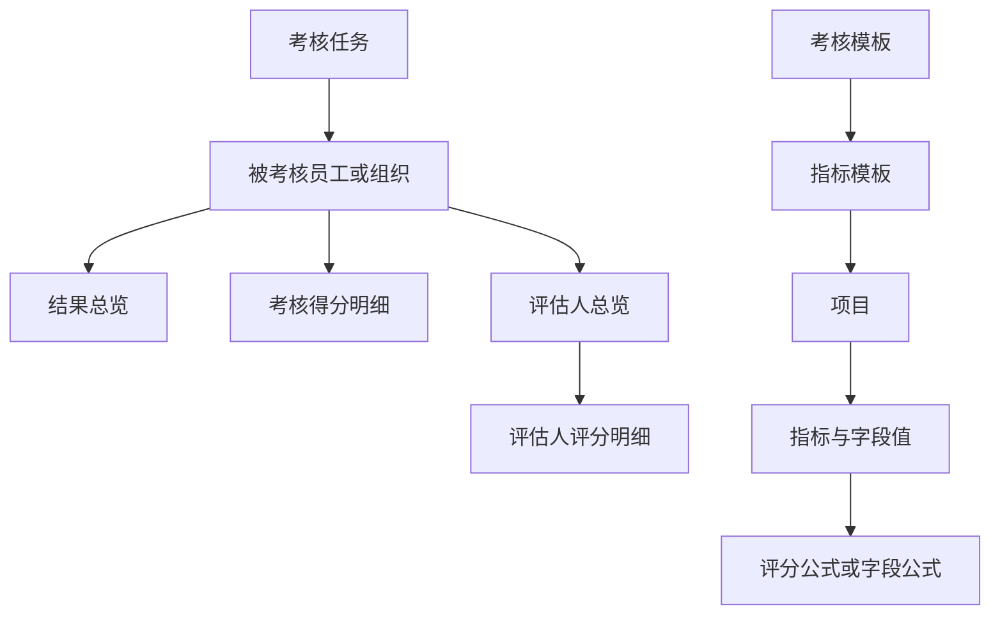

# 智慧绩效结果与指标模板

## 模块定位

Smart KPI 负责在 iHR 中呈现员工或组织的绩效考核结果，并维护考核模板下使用的指标模板配置。它用于回答“某项考核结果如何”“谁参与了评分”“指标模板包含什么”，以及按确认后的完整载荷保存或从文件导入指标模板。

## 考核方案

考核方案是员工或组织绩效任务的配置入口，包含基本信息、考核周期、范围、流程和结果设置。方案管理与考核模板、指标模板导入是不同目标；方案命令及构参规则见 [考核方案管理](../commands/programme/programme-management.md)。

## 主要业务内容

| 业务主题 | 业务含义 | 需要区分 |
| --- | --- | --- |
| 绩效结果总览 | 按考核任务汇总员工或组织的当前结果、分数、等级和状态 | 总览不包含完整指标得分与评估人评分明细 |
| 考核得分明细 | 展示被考核对象在维度、项目、指标和动态字段上的得分与业务值 | 被考核对象得分不等于某位评估人的评分 |
| 评估人数据 | 分为评估人总览和评估人评分明细 | 总览缺少项目或指标不能解释为没有评分明细 |
| 考核模板 | 定义员工或组织考核使用的模板范围，是指标模板新建或更新的归属目标 | 考核模板不是要保存的指标模板 |
| 指标模板 | 由项目、指标、字段值、单位、分类、指标库引用和公式配置组成 | 列表摘要不能替代新建结构或更新详情底稿 |
| 公式校验 | 校验单条公式或同一指标内的字段公式集合 | 校验请求成功不等于公式业务语义正确，也不等于模板已保存 |
| 任务进度与催办 | 按年度和周期精确查询任务当前节点、节点待处理人员并对确认范围催办 | 周期由 `+scan` 内部解析；`stayDays > 7` 等异常判断由业务 Skill 完成 |
| 计量单位 | 当前公司已启用的指标计量单位 | 列表看不到停用单位；保存不返回 ID |
| 指标库 | 维护通用/能力素质/价值观指标及其分类与字段 | 管理列表是包含匹配，不等于指标模板精确引用 |
| 考核模板管理 | 查询并受确认地保存基本信息、项目和权限，以及复制与启停 | 不等于指标模板导入；导入只用列表选考核模板 |
| 文件导入 | 从 Excel、CSV 或可提取文本构造完整指标模板并受确认保存 | 导入过程状态只存在于当前工作空间按 `sessionKey` 隔离的 `state.json` |

## 关键关系与判断

- 绩效结果按考核任务和被考核对象组织；结果总览、得分明细、评估人总览和评估人评分明细是不同粒度的结果。
- 指标模板必须归属于已经确认的考核模板。新建读取当前模板结构，更新读取目标指标模板完整详情。
- 更新提交的是完整状态；文件没有提到的现有指标默认保留，只有用户明确确认删除的内容才能移除。
- 保存确认绑定当前完整载荷。目标、底稿、映射、值、公式或传输结果变化后，原校验、预览和确认失效。

## 边界与限制

### 相邻模块边界

- Staff 的历史绩效档案属于员工档案记录，不等于 Smart KPI 当前考核结果。
- Organization 负责部门、职位、汇报关系等组织定义；Smart KPI 只按已公开条件查询组织绩效结果。
- Payroll 负责薪资和绩效奖金数据；Smart KPI 不设计或计算薪资方案。

### 当前执行边界

- 绩效结果的 8 个组合命令全部只读，不自动分页、拆分任务或重试。
- 指标模板导入使用命令导航中的考核模板、结构、列表、详情、分类、单位、指标库、公式校验和保存命令。
- 文件导入当前只支持 Excel、CSV 和可直接提取文本的文件；图片、扫描件或必须依赖 OCR 的内容不进入该 Use Case。
- 导入过程状态只用于当前 Agent Session 内的多轮确认和上下文压缩恢复，不提供跨 Session 草稿。

### 易错判断

- 查询命令成功、公式校验请求成功、保存请求成功和写后业务状态验证是不同完成边界。
- 内部任务、被考核对象、节点和评估人 ID 只能来自公开命令前序结果，不能要求用户注入。
- 权限不足、结构不完整或候选不唯一时停止，不使用 raw API 绕过。

## 进一步读取

### 业务知识

| 当前问题 | 读取内容 |
| --- | --- |
| 绩效查询粒度、结果关系、动态字段和安全展示 | [绩效结果](performance-results.md) |
| 考核模板、指标模板、完整更新、公式和保存边界 | [指标模板](norm-template.md) |
| 面向客户展示总览、得分、评估人数据或错误 | [客户展示](presentation.md) |

### 命令与复杂目标

- 选择命令或判断返回摘要：[Smart KPI 命令导航](commands.md)。
- 根据 Excel、CSV 或文本设计并保存指标模板：[从文件设计并导入指标模板](../use-cases/norm-template-import/guide.md)。

明确命令请求直接定向定位命令导航中的对应条目，再按条目声明的来源读取 Help 或命令 Reference，不加载无关业务知识。
