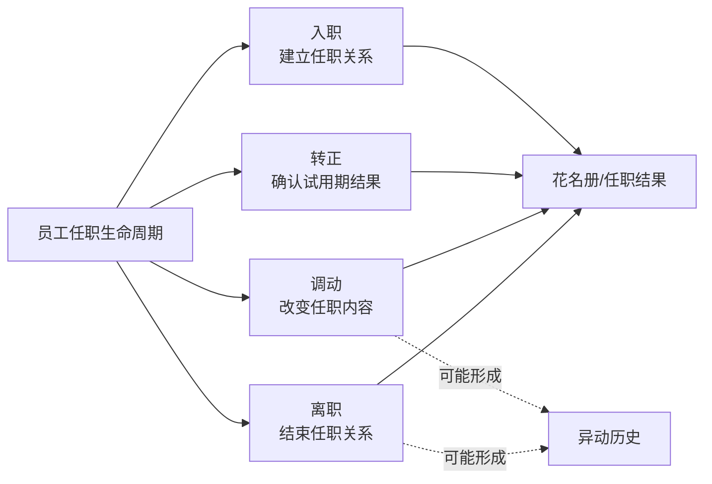

# 入职、转正、调动与离职业务流程

“入转调离”是人力资源管理中围绕员工任职关系变化的四条业务流程：入职、转正、调动、离职。它们不是四种并列的普通记录，也不是一个必须从头走到尾的总流程。

每条流程都有自己的业务目标和完成结果；流程内部可以产生业务表单、审批申请、登记资料、交接事项和历史变化记录。这些过程对象必须分开识别，不能用其中一个对象代替整条流程。



## 1. 四条流程的业务定位

| 流程 | 业务起点 | 业务目标 | 主要结果事实 | 常见过程对象 |
| --- | --- | --- | --- | --- |
| 入职 | 候选人或待入职人员尚未形成正式员工任职关系 | 将拟入职资料审核、确认并归档为员工 | 花名册产生或补全员工主记录，并有实际入职结果 | 待入职表单、入职信息、入职登记表、入职审批 |
| 转正 | 员工处于试用期 | 根据试用期考核和审批结果确认是否转为正式任职 | 转正业务完成，必要时更新员工转正日期/任职状态 | 转正单、转正审批、试用期考核 |
| 调动 | 员工已有任职关系 | 变更部门、职位、职级、地点、合同公司、主管或薪资等任职内容 | 指定时点的任职内容发生变化，可能形成异动历史 | 调动单、调动明细、调动审批 |
| 离职 | 员工已有任职关系，产生结束任职的安排 | 完成离职确认、审批、交接和离职结果处理 | 离职业务完成；员工主记录和相关下游系统是否已完成需分别验证 | 离职单、离职审批、交接申请、交接对象 |

四条流程可以发生业务联动，但不共享一个“总状态”。例如员工离职可能导致未完成的转正流程被自动放弃；这仍然是两个流程之间的联动，不把转正记录改称为离职记录。

## 2. 流程、审批与结果的关系

每条流程至少要区分以下事实：

1. **业务办理事实**：这条人事流程本身推进到什么状态。
2. **审批事实**：关联审批申请处于什么状态。审批是流程中的一个环节，不拥有入转调离的业务定义。
3. **辅助事项事实**：例如入职登记、试用期考核、离职交接等子事项的状态。
4. **任职结果事实**：花名册或任职历史是否已经反映流程结果。
5. **下游处理事实**：考勤、薪资、福利、账号或权限等系统是否完成后续处理。

这些事实的状态和时间可以不同。审批通过不等于业务办理完成，业务办理完成也不自动等于员工主记录或下游系统已经完成更新。

## 3. 入职流程

入职流程解决“候选人/待入职人员如何成为员工”的问题，主要过程对象包括：

| 过程对象 | 业务含义 | 不能替代的事实 |
| --- | --- | --- |
| 待入职表单 | 保存拟入职资料、预计入职日期和办理状态 | 不等于已归档员工 |
| 入职信息 | 承载候选人的入职资料 | 不等于登记审核通过 |
| 入职登记表 | 候选人提交、供 HR 审核的登记资料 | 审核通过不等于员工已经归档 |
| 入职审批 | 对入职事项进行审批的过程 | 审批通过不等于花名册已有员工 |
| 员工主记录 | 入职确认后的正式员工任职结果 | 不能反向证明所有入职资料和审批环节均已完成 |

当前 Agent 可用的入职命令包含查询、待入职表单的有限办理，以及登记表审核；报告“已入职/已归档”时，应以确认结果和花名册回读作为证据。

## 4. 转正流程

转正流程解决“试用期员工是否转为正式任职”的问题。它通常同时涉及：

- 转正办理状态；
- 转正审批状态；
- 试用期考核状态和考核结果；
- 计划转正日期、实际转正日期以及员工主记录结果。

`STAY_CONFIRM`、`HAS_CONFIRM`、`COMPLETED`、`GIVE_UP` 和 `QUIT_GIVE_UP` 是转正办理状态值。`QUIT_GIVE_UP` 的含义是因员工离职而自动放弃未完成的转正流程，不是普通的人工放弃。

转正列表中的 `pending/completed` 是查询分支，不是审批状态；列表进入 `completed` 分支也不能单独证明员工主记录已经完成转正。当前 Agent 仅有 `staff positive +search` 列表查询。

## 5. 调动流程

调动流程解决“员工的任职内容发生变化”的问题。它不一定改变员工与公司的关系，但可能改变：部门、职位、职务、职级、工作地点、合同公司、直属主管或薪资等内容。

调动过程至少要区分：

- 原任职内容与目标任职内容；
- 调动办理状态与调动审批状态；
- 计划调动日期、确认调动日期和实际生效时间；
- 当前花名册任职结果与历史异动结果。

目标部门或目标职位只是调动方案中的计划引用。只有指定时点的花名册任职结果或异动历史能够证明调动已经生效。当前 Agent 仅有 `staff transfer +search` 和租户调动设置查询，没有调动详情或办理命令。

## 6. 离职流程

### 6.1 业务定位

离职流程解决“如何结束员工任职关系”的问题。离职记录是这条流程产生的一个过程对象，可能处于办理中，也可能已经进入完成分支；存在离职记录不等于员工已经离职。

离职流程通常包含离职安排、审批、工作交接和结果归档几个方面，但是否启用某个审批或交接环节取决于租户配置和具体业务路径。

### 6.2 三个状态维度

当前后端模型为离职流程定义了三个不同的状态维度。它们不是一条包含若干步骤的单一状态机，也不要求同步变化。

#### 离职办理状态

| 代码 | 业务名称 | 回答的问题 |
| --- | --- | --- |
| `STAY_CONFIRM` | 待确认 | 离职安排是否还等待确认 |
| `HAS_CONFIRM` | 已确认 | 离职安排是否已经确认 |
| `COMPLETED` | 已完成 | 离职办理状态是否进入完成结果 |
| `GIVE_UP` | 已放弃 | 该离职办理是否被放弃 |

这些名称来自 Staff 后端枚举；它们只解释离职办理状态，不代表审批、交接或员工主记录状态。

#### 离职审批状态

当前枚举共有 11 个值，但它们是审批申请生命周期的可用状态集合，不代表每一条离职流程都会依次经历全部状态：

| 代码 | 业务名称 | 说明 |
| --- | --- | --- |
| `UN_START` | 未发起 | 尚未发起审批 |
| `INITIATE` | 审批中 | 审批申请正在处理 |
| `WAITING_HR_APPROVAL` | 待归档 | 等待 HR 归档处理；不要按代码字面翻译为“等待 HR 审批” |
| `ARCHIVE` | 已归档 | 审批申请已归档 |
| `PASS` | 已通过 | 审批结果通过 |
| `DENIED` | 已驳回 | 审批结果被驳回 |
| `ABANDON` | 已放弃 | 审批申请被放弃 |
| `ABANDONED` | 已作废 | 审批申请已作废 |
| `CANCEL` | 已撤回 | 审批申请被撤回 |
| `BACK` | 已退回 | 审批申请被退回 |
| `DELETE` | 已删除 | 审批申请已删除 |

`PASS`、`ARCHIVE`、`COMPLETED` 分别属于审批结果、审批归档和离职办理状态，不能合并成一个“已完成”。旧接口注解中仍出现 `PROCESSING/PASSED/REJECTED` 等历史值；Agent 应以当前 CLI Schema 和实际枚举为准，不混用旧值。

#### 工作交接状态

| 代码 | 业务名称 | 回答的问题 |
| --- | --- | --- |
| `UN_START` | 未开始 | 交接尚未开始 |
| `WAITING_HR_APPROVAL` | 待归档 | 交接等待 HR 归档处理 |
| `COUNTERSIGN` | 会签中 | 交接事项正在会签 |
| `PASSED` | 已通过 | 交接会签通过 |
| `ABANDON` | 已放弃 | 交接事项被放弃 |

交接状态只解释交接申请，不代表离职办理或员工离职结果。

### 6.3 日期与事实边界

当前离职对象和查询契约中能确认的日期含义如下：

| 日期 | 业务含义 | 不能解释为 |
| --- | --- | --- |
| 预计离职日期 | 计划中的离职日期 | 实际离职已经发生 |
| 确认离职日期 | 离职安排确认使用的日期 | 审批通过或花名册已变更 |
| 最后工作日 | 员工最后实际工作的日期 | 计薪、社保或福利处理已经完成 |
| 计薪截止日期 | 薪资处理使用的截止日期 | 薪资结算已经完成 |
| 入职日期 | 查询离职人员时的辅助筛选条件 | 离职流程的开始时间 |

当前 `staff quit +search` 没有一个统一且已公开的“离职生效时间”字段。后端内部可能存在归档或任职更新时间，但在 CLI 没有明确返回契约前，Agent 不得用“生效时间”替代上述日期。

以下事实必须分别查询和报告：

- 离职流程记录存在；
- 离职审批已通过；
- 离职办理状态为 `COMPLETED`；
- 员工花名册 `staffStatus=QUIT`；
- 员工异动历史出现 `QUIT`；
- 考勤、薪资、社保、公积金或其他福利处理完成。

一个事实不能自动证明其他事实成立。下游流程是否需要执行以及何时完成，必须由对应业务域提供证据。

### 6.4 当前 Agent 能力

在当前 `ihr-cli` 的公开 Agent 能力范围内，离职流程只提供：

```text
staff quit +search
```

它是分页列表查询，支持待离职/已离职查询分支、人员和部门筛选、离职办理状态、审批状态、交接状态、离职类型和日期条件；不提供离职详情、创建、提交、审批、确认或生效办理命令。

`--state=pending/completed` 是查询列表分支，`--status` 是离职办理状态筛选。特别是：`state=completed` 不等于 `status=COMPLETED`，也不等于 `staffStatus=QUIT`。

由于当前响应的离职记录项仍是开放对象，Agent 只能使用实际返回的字段；未由 CLI Schema 或返回结果确认的字段不能补写到业务结论中。

## 7. 跨流程结果判断

| 用户目标 | 应验证的主要事实 | 不能单独替代的事实 |
| --- | --- | --- |
| 确认人员已完成入职 | 入职确认结果 + 花名册员工回读 | 登记表审核通过、审批通过 |
| 确认人员已完成转正 | 转正办理状态及必要的员工任职结果 | `completed` 查询分支、审批通过 |
| 确认调动已经生效 | 指定时点的花名册任职结果或异动历史 | 目标部门/职位引用、审批通过 |
| 确认人员已经离职 | 离职办理完成结果，并按目标补充花名册或异动证据 | 审批通过、最后工作日、下游结算 |

当前 CLI 无法取得目标所需的权威事实时，必须报告“未验证”或停止，不根据相邻状态自行补全流程结论。

参数、分页和命令输入边界见[入转调离查询命令](../commands/lifecycle-records.md)。
