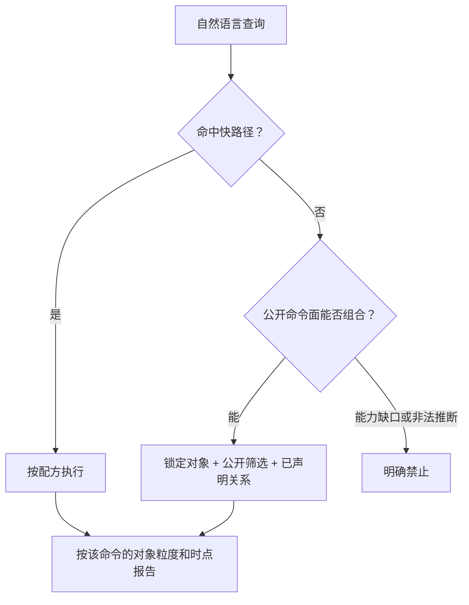

# Staff 查询语义

把自然语言落到当前公开命令上。先按快路径执行；没命中就用公开筛选和已声明关系组合。分页遵循 [`ihr-shared` 查询分页](../../../ihr-shared/SKILL.md#查询分页)。

## 1. 快路径

命中下表时直接用配方。未命中时继续组合公开命令。

| 用户问法 | 对象 | 命令配方 | 结果应如何称呼 |
| --- | --- | --- | --- |
| 找人、按姓名/工号/手机号查员工 | 员工 | `staff +search`；唯一候选再 `staff +get` | 0 候选、1 名员工或多候选；禁止抢第一条 |
| 某员工详情 | 员工 | 已有唯一 `staffId` 时 `staff +get` | 当前花名册详情 |
| 某类固定档案，如教育/工作/证书/家庭/绩效 | 档案记录 | `staff +archiveList` + 对应 `meta-data-code` | 档案记录列表或分页总数，不是员工人数 |
| 自定义档案 | 企业自定义档案记录 | `staff +archiveList` 或唯一员工的 `staff +archiveGet` | `SUBSET` 记录，不与固定档案混用 |
| 字段选项、档案结构、Flex Meta | Flex Meta | `staff +flexMetaList` / `+flexMetaGet` / `+flexMetaValueList` / `+flexMetaValueTree` | 定义和选项，不是员工字段值 |
| 待入职名单或数量 | 待入职表单 | `staff entry +search --state pending` | 待入职表单；有总数时用分页总数 |
| 已确认入职名单或数量 | 入职表单 | `staff entry +search --state joined` | 已确认入职表单，不等于当前在职员工 |
| 当前在职/离职有多少人 | 员工 | `staff +search --status active` 或 `--status inactive` | `response.data.totalElements`；当前时点、当前权限范围 |
| 待转正/已转正、待离职/已离职 | 流程单据 | `staff positive +search` 或 `staff quit +search`，按 `--state` | 单据数；不要改称去重员工人数 |
| 调动单 | 调动流程对象 | `staff transfer +search` | 调动单列表或分页总数 |
| 合同、协议、已发生异动 | 对应记录 | `staff contract/agreement/change-record +search` | 记录数，不是人数 |
| 培训有多少 | 四类培训记录 | `staff training count` | 四类记录数分别报告，不能相加后称培训人数 |
| 某员工四类培训明细 | 培训记录 | 对应 `course-record-page` / `exam-record-page` / `learnmap-record-page` / `offline-training-record-page` | 单员工当前页记录 |

日期筛选只能使用该命令当前公开的日期字段。预计日期、确认日期、最后工作日、异动时间和创建时间不能互换。

## 2. 组合规则

未命中快路径时，按当前公开命令面组合。对象、术语和关系仍以 [Staff Overview](overview.md)、[业务对象与关系](business-objects-and-relations.md) 和 [术语与概念辨析](terminology.md) 为准，本文件不复制本体。

1. **先锁定对象。** 员工、某类档案、待入职表单、转正/调动/离职单据、合同/协议/异动/培训记录不是同一个查询。对象不唯一时只问一个能改变命令选择的问题。
2. **定位身份。** 姓名、工号、手机号先 `staff +search`，按 0/1/N 处理：0 只能说当前条件未返回记录；1 可继续详情或其他记录查询；N 先确认，禁止默认第一条。部门、职位名称转 ID 走 `ihr-master-data`，不要用花名册名称或组织树凑 ID。姓名不能当跨表连接键。
3. **只用公开筛选和已声明关系。** Help/Schema/命令 Reference 没有的字段、状态、日期不能发明。花名册部门引用是查询时点的当前任职，不是历史归属。
4. **分页总数是该行粒度的匹配数。** 真分页命令返回的 `totalElements` 或契约确认的等价总数字段，就是当前筛选、当前权限、当前执行时点下该对象行数。仅当用户只要数量、总数已能完整回答、并且没有要求拉取全部行时，才用总数、不读完全部页。
5. **未登记也可以查。** 例如“研发待入职多少”：先解析研发部门 ID，再 `staff entry +search --state pending --department-id ...`，用该筛选的分页总数回答。不要因为快路径没有“研发待入职”就停止。
6. **完整名单和返回字段分析可以串行翻页。** 用户明确要完整名单、统计分析，或需要先拿到完整结果再处理时，在范围明确、分页元数据可靠的前提下，保持筛选和字段投影不变，从首页按页码顺序串行翻页；**禁止并发请求多页**，禁止自动重试。每页条数以该命令 Help/reference 为准，不要臆造 `pageSize`。任一页失败、分页元数据矛盾、重复页或 HTTP 429 时停止，只报告已覆盖范围。黑名单、入职审批待办和入职登记表审核列表同样适用，但不得导出或扩大到未确认范围。
7. **同一命令返回字段上的去重、分组和分布可以做。** 例如按花名册已返回的部门字段汇总当前在职人数分布。必须说明筛选、时点和是否完整覆盖；未完整覆盖不得宣称全量。不能用未返回或未公开的字段做分组。
8. **口径不能升级。** 翻页得到的名单、行数或返回字段汇总，只能称为“当前筛选下的名单/行数/分布”，不能说成官方离职率、入职率、平均在职，或某天当时的在职人数。
9. **跨命令结果分别报告。** 可以并列查询多个对象，但不要把不同粒度加总或改名成新的系统指标。

没有可靠分页契约的树、单对象和 count 命令，不自动翻页或递归补查。

## 3. 明确不支持

只停止下面两类目标。快路径里没有，不是停止理由。

### 能力缺口

当前公开命令给不出这个事实：

- 花名册 `+search/+get` 是当前任职，没有按某天当时在职的查询。入职/离职/异动的公开日期字段可以筛单据，不要把单据日期筛完说成那天的在职花名册；
- 需要官方分母的主动离职率、入职率、平均在职人数，以及月度/年度净增或趋势；
- 用当前命令未返回或未公开的字段做分组、分布或聚合；
- 工资总额、平均工资、薪资分布；这些不属于 Staff。

### 非法推断

即使命令能返回另一种数据，也不能改称为用户要的事实：

- 用合同数、协议数、档案记录数、培训记录数或入职/转正/调动/离职单据数代替员工人数；
- 用审批通过、办理完成或目标部门引用证明新任职已经生效；
- 用空列表证明对象不存在；空结果只说明当前请求未返回记录；
- 把多个不同粒度的结果拼成新公式，还当作系统指标。

本地翻页得到的名单、行数或返回字段汇总，必须保持“当前筛选、当前时点、当前权限范围”的说法。

## 4. 执行提醒

1. 先按[公开命令导航](commands.md)定位命令，再读该条目要求的 Help、Schema 或过渡 Reference。
2. 未给时间的“现在”使用命令执行时点，并在回答中说明当前权限范围。
3. 每个计数、名单或分布至少说明：对象粒度、筛选、时点、权限范围、数据来源和是否完整覆盖。
4. 写入、确认入职和登记表审核仍走对应 Use Case；本文件只约束查询。
